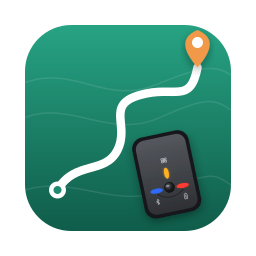
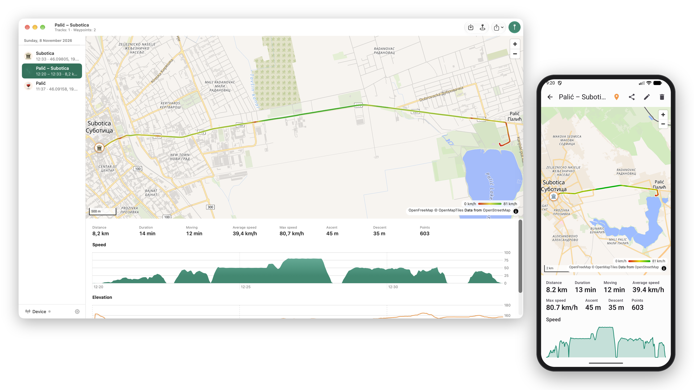
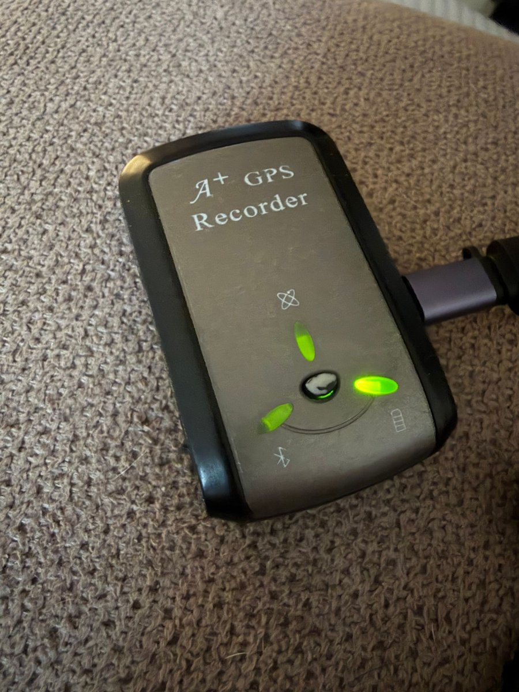
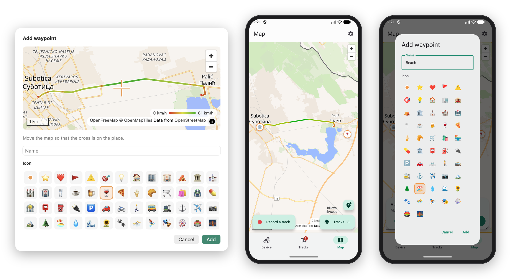

<p align="center"></p>

<h1 align="center">A747 GPS Logger</h1>

<p align="center">
Unofficial companion apps for the <b>TranSystem i-Blue 747A+</b> GPS data logger.<br>
Read its memory, see your tracks on a map, export GPX / KML / CSV.<br>
<b>macOS</b> (USB) · <b>Android</b> (USB OTG and Bluetooth) · 19 languages · no accounts, no tracking.
</p>

<p align="center">

</p>

> Not affiliated with TranSystem Inc. "i-Blue" and "747A+" are used only to say which device
> these apps work with. The protocol was worked out from public sources and by observing a
> real device.

## Why



The 747A+ is a pocket GPS logger sold around 2008–2012. It still works well: it logs for
days, has a button to mark places, and talks NMEA over USB and Bluetooth. The software around
it has not aged as well:

- the vendor's tools are Windows-only and long abandoned;
- on current macOS the logger gets **no serial port at all** (`/dev/cu.*` never appears), so
  BT747 and `gpsbabel -i mtk` cannot reach it;
- the logger keeps **one continuous log**, not a list of tracks, and its clock is
  **1024 weeks behind** (GPS week rollover), so raw exports are dated around 2006.

These apps fix all of that and give you the tracks in common formats.

## The logger

| | |
|---|---|
| Model | TranSystem i-Blue 747A+ ("A+ GPS Recorder"), FCC ID OUP971260101 |
| Chipset | MediaTek MT3329, firmware `AXN_1.30-B_1.3_C01` / `TSI_747A+` |
| GPS | L1 C/A, 66 acquisition channels, SBAS (WAAS/EGNOS/MSAS), 1 Hz fixes |
| Output | NMEA 0183 (RMC, GGA, GSA, GSV) plus MTK `PMTK` commands, 115200 baud |
| Connections | Mini-USB (USB CDC, `0E8D:3329`), Bluetooth 2.0 Serial Port Profile |
| Memory | 32 Mbit flash = **4 MB** (the firmware assumes 8 MB, see below) |
| Capacity | ~122 000 points with time, position, height, speed (34 bytes/point); ~109 000 with HDOP and satellite count added |
| Logging | Every N seconds, N metres or above N km/h, whichever comes first; "stop" or "overwrite" when full |
| Controls | Power / NAV / LOG switch; one button that stores a waypoint |
| Battery | Built-in, rechargeable over USB. **Its level is not available over the protocol.** |

### Quirks the apps handle

- **Week rollover.** Timestamps are 1024 weeks old; they are corrected automatically.
- **4 MB, not 8 MB.** The firmware addresses 8 MB, but the chip holds 4 MB. Past 4 MB the
  start of the log is overwritten silently, even in "stop when full" mode. A full download
  reads the same data twice. The apps read only the real size and warn you at 75 %.
- **No serial port on macOS.** The USB descriptor lists the data interface before the control
  interface, so macOS attaches no driver. The Mac app talks to the USB endpoints directly
  (IOKit), no driver or libusb needed.
- **Mixed number bases.** Some replies are hex and some are decimal. Details in
  [docs/protocol.md](docs/protocol.md).

## Features

- **Device**: model, firmware, memory used of the real 4 MB, records, hours of logging left,
  log settings, live fix and satellites, warnings about overflow and switched-off logging.
- **Download**: the first read takes up to ~3.5 min for a full logger; later reads fetch only
  what is new (seconds). On Android it keeps running with the screen off.
- **Download and erase**: erases only after the download is saved and verified, asks twice,
  then switches logging back on and checks it.
- **Tracks**: the log is split into trips at pauses longer than 30 min (adjustable) and grouped
  by day in the **local time of the place** the track was recorded. Each track has a map,
  distance, durations, speeds, ascent/descent and speed/elevation charts. The track is coloured
  by speed (slowest red, fastest green) or in one colour of your choice.
- **Waypoints**: places marked with the button, listed together with the tracks; opening one
  zooms the map to it. Add your own: move the map under a cross (on Android also to where the
  phone is), give it a name and one of 51 icons. Any waypoint can get an icon, shown in the
  list and on the maps.
- **Rename and delete** tracks and waypoints. The raw downloads are kept as they are, and a
  deleted item does not come back with the next download.
- **Export**: GPX 1.1, KML, CSV, or the raw BIN image — one track, a selection, or everything,
  each track in its own file.
  Share to Mail, Messages, Google Drive and so on, or save anywhere including iCloud Drive.
- **Import**: GPX, KML (with times), CSV, NMEA and raw BIN dumps from other programs or other
  devices. Tracks and waypoints already in the library are skipped; names in the files are
  kept. On the Mac, files can also be dropped on the list.
- **Map** (Android): any number of tracks and waypoints on one map, full screen, ticked in a list that the Tracks button opens.
- **Record on the phone** (Android): a track from the phone's own GPS, one point every
  1–60 s, running with the screen off. Start and stop it in the app, from the notification, or
  from [Tasker](#recording-from-tasker) and similar apps.
- **Appearance and language**: light, dark or as in the system; the app's language can differ
  from the system's.
- **Library**: everything downloaded stays on your device; re-downloading never duplicates.
- **19 languages**: English, Russian, Serbian, Ukrainian, Kazakh, Georgian, Spanish,
  Portuguese (Brazil), French, German, Italian, Polish, Turkish, Chinese (Simplified),
  Japanese, Korean, Arabic, Hindi, Indonesian.

Settings on the logger (log format, intervals) are shown but not changed in this version.

<p align="center">

</p>

## Install

Download from [Releases](../../releases).

### macOS 14 or newer

1. Open `A747-GPS-Logger-<version>.dmg` and drag the app to Applications.
2. The app is not notarized (that needs a paid Apple developer account), so macOS blocks the
   first launch. Open it once, then go to **System Settings → Privacy & Security** and click
   **Open Anyway**. Or run:

   ```bash
   xattr -dr com.apple.quarantine "/Applications/A747 GPS Logger.app"
   ```

3. Connect the logger with a USB **data** cable (many cables only charge). It appears on the
   Device screen within a couple of seconds.

### Android 8 or newer

1. Download `A747-GPS-Logger-<version>.apk` on the phone and install it (allow installing from
   your browser or file manager when asked).
2. **USB**: connect the logger with a USB OTG adapter. Android offers to open the app; allow
   access to the device.
3. **Bluetooth**: pair the logger in the system Bluetooth settings (PIN `0000`), then tap
   **Connect by Bluetooth** in the app.

### Recording from Tasker

Use the **Send Intent** action with **Target: Activity** and one of these actions:

```
io.github.a_m_protasov.a747.action.START_RECORDING
io.github.a_m_protasov.a747.action.STOP_RECORDING
io.github.a_m_protasov.a747.action.TOGGLE_RECORDING
```

Start recording once from the app first, so Android asks for location access. After that it
works with the screen locked too. Tasker needs its usual "Display over other apps" permission
to start activities from the background.

## Privacy

The apps have no accounts, analytics or crash reporting. The only network traffic is map tiles
from [OpenFreeMap](https://openfreemap.org). Your tracks stay on your device until you export
them.

## Other loggers

Several MTK-based loggers use the same protocol (Holux M-241, Qstarz BT-Q1000, i-Blue 737 and
747 variants). They may well work but are **untested**. Reports are welcome in Issues.

## Build from source

```bash
# macOS app (Xcode 16+, XcodeGen)
cd macos && xcodegen && open A747.xcodeproj

# Android app (JDK 17+, Android SDK 37)
cd android && ./gradlew :app:assembleDebug

# tests: the Python reference, Swift core and Kotlin core must agree byte for byte
python3 tools/gen_fixtures.py && git diff --exit-code fixtures/
(cd macos/A747Core && swift test)
(cd android && ./gradlew :core:test)
```

How the pieces fit:

| Path | What |
|---|---|
| [docs/protocol.md](docs/protocol.md) | Protocol and log format; the single source of truth |
| [tools/reference](tools/reference) | Python reference implementation used to make the golden files |
| [fixtures](fixtures) | Synthetic logger images with expected GPX/KML/CSV (no real tracks) |
| [macos](macos) | SwiftUI app and `A747Core` Swift package |
| [android](android) | Jetpack Compose app and `core` Kotlin module |
| [shared](shared) | Map page, time zone data, translations, icon — used by both apps |

Translations live in [shared/i18n](shared/i18n). They were machine-translated; fixes from
native speakers are very welcome.

## Credits

- [MapLibre GL JS](https://maplibre.org) (BSD-3-Clause) and [OpenFreeMap](https://openfreemap.org)
  tiles; map data © [OpenStreetMap](https://www.openstreetmap.org/copyright) contributors.
- Time zone boundaries: [timezone-boundary-builder](https://github.com/evansiroky/timezone-boundary-builder),
  © OpenStreetMap contributors, [ODbL 1.0](https://opendatacommons.org/licenses/odbl/1-0/).
- The MTK log format is documented by the [GPSBabel](https://www.gpsbabel.org) and
  [BT747](https://www.bt747.org) projects; this code is an independent implementation.

## License

[MIT](LICENSE).
